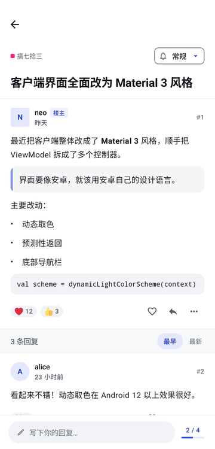
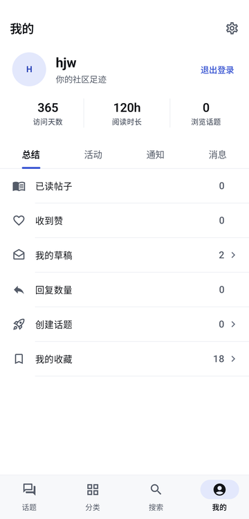

<p align="center">
  
</p>

<h1 align="center">佬友 · LaoYou</h1>

<p align="center">
  给 <a href="https://linux.do/">LINUX DO</a> 佬友们用的安卓原生客户端<br>
  直连免梯 · 会话长效 · 本地推送 · 清爽不打扰
</p>

<p align="center">
  <a href="https://github.com/smhjw/linuxdo-android-hjw/releases/latest"><b>下载最新版</b></a>
  ·
  <a href="https://linux.do/t/topic/2998703">L 站原帖</a>
</p>

<p align="center">
  
  
  
  
</p>

> [!NOTE]
> 佬友是社区爱好者做的**第三方**客户端，不是 LINUX DO 官方应用，与 LINUX DO 站方没有隶属关系。

---

## 为什么用它

| 在网页里常遇到的 | 佬友怎么处理 |
|:--|:--|
| 频繁卡在 Cloudflare 盾，甚至 403 | 把论坛会话（`_t`）和设备级 `cf_clearance` 分开管理，偶发的人机验证在应用内闭环，日常刷帖不再反复跳盾 |
| 不开梯子打不开，开了又慢 | 内置 DoH + ECH 加密直连，多路节点测速择优；检测到系统 VPN / 代理时自动让路 |
| 切到后台就收不到回复提醒 | 短 WakeLock 守护的轻量轮询，亮屏、回到桌面时即时拉取，适配主流 ROM 的桌面角标 |
| 发帖得跳回网页，草稿容易丢 | 原生发帖：分类、标签、图文混排编辑、多图上传，草稿自动保存 |

## 功能

- **阅读**：最新 / 未读 / 热门 / 我的帖子，置顶自动收成一行；楼中楼树形视图，正序 / 倒序切换，阅读进度随时回到 1 楼。
- **互动**：点赞与回应表情、简评、书签、复制楼层链接、编辑、删除、举报；单个话题可设「关注 / 跟踪 / 常规 / 免打扰」。
- **创作**：发布新话题与回复，所见即所得编辑，Markdown 快捷插入，图片与附件上传，本地草稿箱。
- **分类**：长按拖动自定义分类顺序，可加自定义版块；关注的版块与网页端双向同步。
- **登录**：账号密码、邮箱验证码、两步验证（动态口令与恢复码），遇到风控可一键改用网页授权。
- **网络**：DoH + ECH 安全直连，节点测速与故障自动切换。
- **通知**：后台轮询推送、桌面未读角标、多档保活策略。
- **更新**：应用内检查新版本，下载后自动校验 SHA256 再安装。

## 界面：「清简」

新版界面重做成了更安静的样子：

- **不放浮层**：发帖在顶栏、排序在标签行，"新动态"是列表里的一行，回复框固定在底部，不再有按钮压在内容上。
- **平铺列表**：没有卡片套卡片和阴影，只用发丝分割线，一屏能看到更多话题，滚动也更省。
- **中性灰 + 一种强调色**：浅色 / 深色 / 跟随系统三档外观，安卓 12 以上可在设置里改用壁纸取色。

## 下载与安装

- 到 [Releases](https://github.com/smhjw/linuxdo-android-hjw/releases/latest) 下载最新的 APK。
- 需要 **Android 8.0 及以上**，目前只提供 **arm64-v8a** 安装包。
- 本仓库的安装包用自己的签名发布，和上游原版签名不同：**装过原版的话需要先卸载**，之后应用内更新都会指向本仓库。

> [!TIP]
> - 不挂代理直连时，建议在「设置 → 网络与缓存」里开启安全直连（DoH），挑一个延迟最低的节点。
> - 登录时遇到 `CSRF 403` 或风控提示，可以换个节点，或直接点登录页下方的「网页授权登录」。
> - 「同步楼层与阅读时长」默认关闭，需要累计阅读时长的佬友可自行开启（可能增加触发验证的概率）。

## 自己构建

```bash
./gradlew assembleDebug
```

- 需要 JDK 17 与 Android SDK（compileSdk 36）。
- 构建 release 包时，在项目根目录放一个 `keystore.properties`（已被 gitignore），写上 `storeFile`、`storePassword`、`keyAlias`、`keyPassword`；没有这个文件时 release 包不签名。

技术栈：Kotlin · Jetpack Compose（Material 3）· OkHttp · Coil · Jsoup · kotlinx.serialization。

## 致谢

- **原作者 [xuemk](https://github.com/xuemk)**：佬友 fork 自 [xuemk/linuxdo-android](https://github.com/xuemk/linuxdo-android)。直连、过盾、推送这些最难啃的部分都是原作者打下的基础，没有它就没有这个项目。
- **[LINUX DO](https://linux.do/) 社区**：感谢站长 neo 和每一位佬友。名字「佬友」就取自社区里大家的互称；也感谢在[原帖](https://linux.do/t/topic/2998703)里提建议、帮忙测试的各位。
- Special thanks to the original author [xuemk](https://github.com/xuemk) and the [LINUX DO](https://linux.do/) community.
